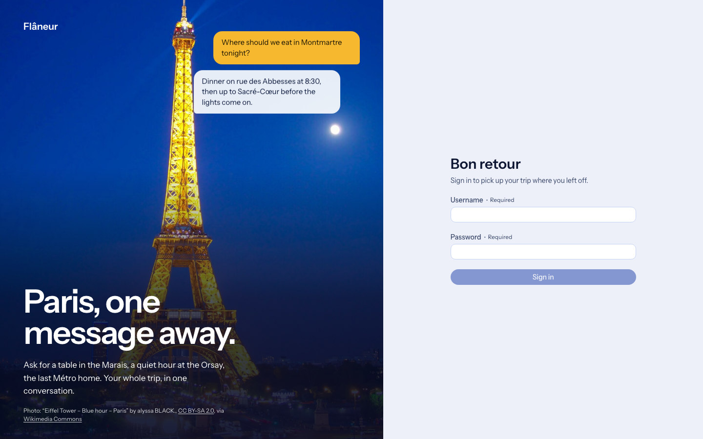
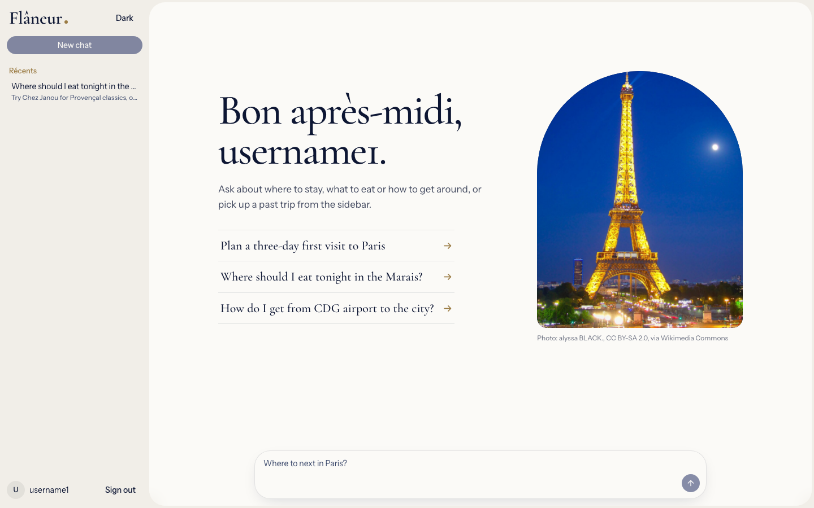
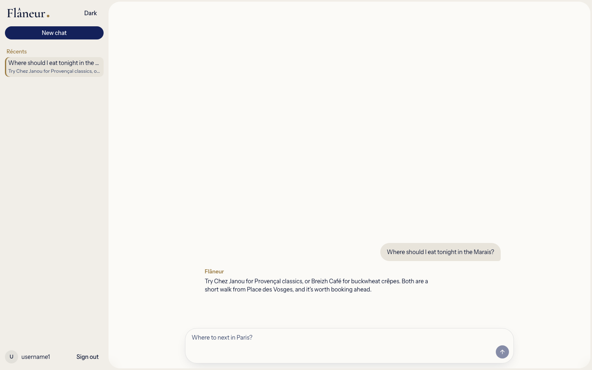

# OpenAI Chatbot

A chat app with a FastAPI backend and a Next.js frontend. Users log in with a username and password, and the backend forwards their messages to an LLM through the OpenAI SDK, pointed at [OpenRouter](https://openrouter.ai). Conversations are kept per user.

## Screenshots

### Login



### New chat



### Conversation



## Project structure

```
.
├── main.py          # FastAPI app and routes
├── config.py        # Settings loaded from .env
├── helpers/         # JWT and password hashing (argon2)
├── schemas/         # Pydantic models
├── requirements.txt
├── docs/screenshots/ # Images used in this README
└── client/          # Next.js 16 frontend (React 19)
```

## Prerequisites

- Python 3.10+
- Node.js 20+
- An OpenRouter API key

## Backend setup

```bash
python -m venv .venv
source .venv/bin/activate
pip install -r requirements.txt
```

Create a `.env` file in the project root:

```env
OPENAI_API_KEY=your-openrouter-api-key
AI_MODEL=openai/gpt-4o-mini   # any model ID available on OpenRouter
SECRET_KEY=a-long-random-string
ALGORITHM=HS256               # optional, defaults to HS256
CORS_ORIGINS=http://localhost:3000   # optional, comma-separated
```

Run the API:

```bash
uvicorn main:app --reload
```

It listens on `http://localhost:8000`. Interactive docs are at `/docs`.

## Frontend setup

```bash
cd client
npm install
npm run dev
```

Open `http://localhost:3000`. The frontend calls the API at `http://localhost:8000` by default. To change that, set `NEXT_PUBLIC_API_URL` in `client/.env.local`.

## API

| Method | Endpoint                | Auth   | Description                                      |
| ------ | ----------------------- | ------ | ------------------------------------------------ |
| POST   | `/api/v1/auth/login`    | None   | Log in. Returns an access token and chat history |
| POST   | `/api/v1/users/create`  | None   | Register a user. Returns an access token         |
| POST   | `/api/v1/messages/chat` | Bearer | Send a message. Omit `id` to start a new chat    |

All responses use the same envelope: `{ "status", "message", "data" }`.

## Notes

- Users and conversations are stored in memory, so they reset whenever the server restarts. Two demo users (`username1` and `username2`) are seeded at startup.
- Never commit `.env`. It holds your API key and signing secret.
